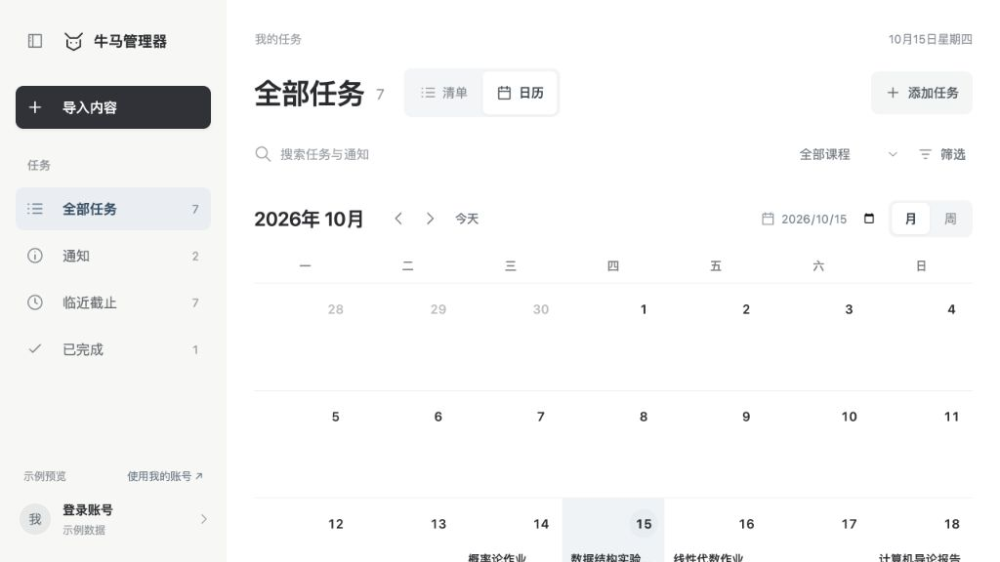
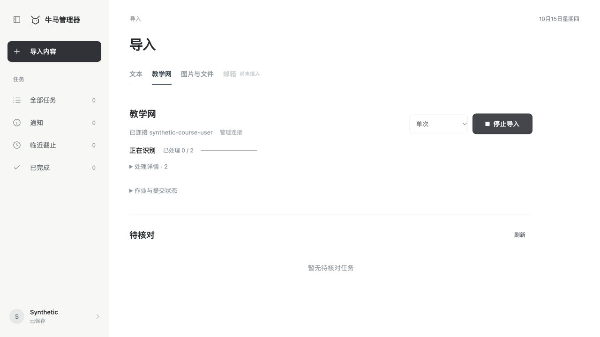
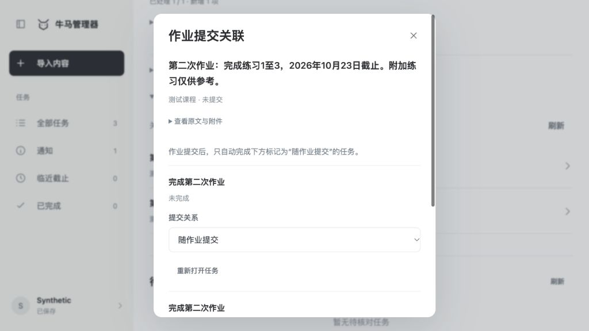
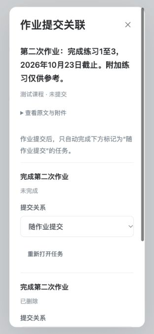

# 当前界面规格

## 产品范围

主界面突出任务内容，功能入口集中且容易点击。两条主要路径是“导入通知”和“查看、处理任务”；不在主页面增加统计卡片、宣传文案或其他工作台。

导入来源包括文本、教学网和图片与文件。邮箱保留显式禁用入口，尚未接入。任务支持新增、编辑、完成、重新打开、删除到回收站和恢复；账号位于侧栏底部。当前不提供学习规划、任务拆分、时段安排或计时功能。

真实数据属于登录账号并保存到服务端。`demo=1` 只展示合成任务：操作留在页面内存，刷新重置，文本和任务不发送到识别、采集或账号保存接口。视图偏好可以保存在浏览器，公开环境信息可以读取。

## 视觉原则

通知使用独立入口、浅灰标签和日历中的灰色卡片。列表左侧与详情底部都可勾选“已阅读”，取消勾选恢复未阅读，两处状态同步。读取既有 `content_type`；阅读状态复用任务状态，通知的 completed / done 表示已阅读，其他可见状态表示未阅读，不新增接口字段或执行历史数据迁移。

用户强调黑白文字层级、充分留白和少量颜色。页面不依靠彩色卡片或成片黑色块突出内容；黑色主要用于文字与主操作，浅暖灰区分功能区域，雾蓝只用于日期和轻选中态。

60 / 30 / 10 是面积与视觉权重的指导：主要内容约占六成，功能区域和次层信息约占三成，关键操作与选中态约占一成。它不要求给三块区域分别涂满颜色，也不要求强行增加蓝色面积；先保证内容、导航、操作的层级，再按实际页面调整留白。

| 层级 | 表现 |
| --- | --- |
| 主要内容 | 白色任务区域，最清晰的正文对比与主要阅读空间 |
| 功能区域 | 浅暖灰侧栏与少量中性底色，导航和任务内容明确分开 |
| 主操作 | 黑色按钮、简短动词和可识别图标 |
| 选中与日期 | 少量雾蓝或浅灰底，使用形状与字重共同区分 |
| 辅助信息 | 中灰文字，字号降低但保持清楚可读 |

桌面页面标题为 29px，导入与任务复用紧凑单行标题组件，标题统一上移，标题大小、标题行和第一控件起点一致；日期位于共享顶栏右上，标题不保留日期或眉题占位行。任务名称约 17–18px、当日面板任务约 15px、课程和来源约 11–12px。层级同时依靠字号、字重、位置和留白；不以浅到难读的颜色区分信息。任务名称允许自然换行，避免为了容纳冗长标签压缩正文。

## 布局与入口

- 桌面固定收放按钮切换 232px 侧栏与 72px 图标栏；折叠后可直接点击导入、全部任务、通知、临近截止、已完成和账号，悬停约 500ms 或键盘聚焦时显示名称。导入为明显主入口，任务范围位于同一区域，账号固定底部。
- 所有页面位于 `app.js` 统一的 `.page-frame` 内，最大宽度 1450px；紧凑顶栏右上显示日期，顶部栏、提示和页标题共用坐标，清单与日历切换时标题和查询区不位移。
- 内容阅读区 `.page-reading` 最大宽度 860px、左对齐，日历使用框架内较宽区域；后续页面共用紧凑顶栏，复用仅渲染单行标题、控件和操作的 `renderPageHeading` 与 `.page-frame`，仅在内部调整阅读区或宽视图。
- 任务详情采用约 420px 的右侧抽屉，背景清单和查询状态保留。
- 700px 为手机布局断点：侧栏保持可关闭的抽屉菜单，不使用桌面图标栏，顶部保留导航触发按钮；任务抽屉适配窄屏。
- 关键触控操作提供至少 44px 有效点击高度。选中状态除了颜色，还使用字重、形状及 `aria-pressed` 或 `aria-current`。

“清单 / 日历”双段开关放在全部任务标题右侧，删除独立标签栏；临近截止与已完成固定使用清单。“月 / 周”只出现在日历内部，避免把所有视图放进侧栏。日期选择和查询控件不与导入入口争夺视觉重点。

## 任务查询与清单

侧栏依次提供全部任务、通知、临近截止、已完成。全部任务清单显示未完成任务；通知清单保留有日期和无日期、未阅读和已阅读的通知，已阅读项保持勾选，方便直接取消。临近截止包含逾期和今天起未来 7 天的未完成任务及未阅读通知；已完成混合展示已完成任务和已阅读通知，相应计数包含两类内容。通知使用浅灰“通知”标签和阅读勾选，关键时间与任务截止分开表述；沿用查询、详情、编辑、回收站和撤销操作。

任务清单按以下顺序分组，空组不显示：已逾期、今天截止、明天截止、未来 7 天、之后截止、无截止日期。任务与通知混合时使用“早于今天”“今天”“明天”等日期表述，不把通知关键时间称为逾期。通知清单与已完成清单平铺，已阅读通知不使用任务的删除线。

通知清单默认按关键时间从早到晚排列：先比较日期，同一天按具体时刻升序，仅有日期的通知排在当天有时刻的通知之后；无有效日期的通知放在最后。相同时间按稳定 ID 排序，已阅读状态不影响位置；搜索、筛选和更新阅读状态后继续沿用此规则。排序只作用于前端展示，不改写服务端数据顺序。

查询区常驻关键词、课程和筛选入口。来源与截止日期范围收在可展开筛选区；组合条件一起生效，全部任务的清单与日历使用相同条件。切换视图、完成任务或关闭详情保留查询、选中日期和浏览范围；从日历进入临近截止或已完成，再返回全部任务时，恢复原月份、日期、月周模式、筛选与视图偏好。

任务行的完成按钮与详情按钮相互独立，不能嵌套按钮。名称是视觉主体，课程、来源与进行中状态退到辅助层；截止日期在清楚的位置显示。查看详情后可编辑任务、标记完成或删除。

## 月历与周历

日历仅属于全部任务页，展示未完成任务的**截止日期**及通知的**关键时间**，不表示执行时段或学习计划；已完成任务不进入日历。通知以灰色卡片和“通知”标签区分，不额外展示类型图例或通知总数，通知不计入任务总数。具体时刻可以展示；未提供时刻时不补造 23:59。

月历周一开头，按月份显示 4–6 行并淡化相邻月份日期。每格最多显示两条任务摘要，更多任务用“+N 项”进入当天清单；今天和选中日期以轻背景或小圆区分。桌面摘要可直接打开任务详情。

周视图按周一至周日列出截止任务，不使用小时网格。月、周支持前后导航、返回今天及指定日期跳转；月份和周范围正确跨年。进入周视图应围绕当前选中日期展示，避免日历与当日面板指向不同时间。

宽屏当日任务在日历右侧，窄屏在日历下方。无日期任务有明确入口，不塞进任何日期格。手机月历隐藏长标题，只显示日期和任务数量，点击后在下方阅读完整清单；手机周视图改为按天的单列列表，避免横向滚动。

编辑过程中如果任务内容被更新或移除，保存时保留草稿并提示重新核对；临时保存失败后可再次保存。删除或恢复失败后，“重试保存”会重试原操作并同步任务与回收站列表。

## 导入与核对

文本页只保留通知输入、可展开的通知时间和识别按钮。教学网页保留连接状态和连接管理，同一操作区选择单次、定时频率或自定义间隔，并使用一个主按钮启动识别或停止定时同步；仅在选择待启动的定时频率后展示明确授权。邮箱入口禁用并明确说明尚未接入。

教学网使用持久化后台采集与识别，进度变化后刷新任务和候选，离开或刷新网页后可恢复；明确任务由后端直接保存，需核对的结果保持手动，前端不再循环调用识别及自动加入。运行时原位主按钮变为带方形停止图标的黑底白字“停止导入”，启用定时服务时显示“停止同步”；停止请求期间显示禁用的“正在停止…”，失败后恢复停止操作并显示错误。状态与紧凑进度紧贴主操作栏下方，进度行不重复提供停止入口；启动前不绘制进度标题或占位，历史中的空记录不显示 0/0。停止先关闭定时服务，再通过后端接口阻止当前运行的后续派发及迟到结果入库，保留已经保存的任务；关闭定时失败仍尝试停止当前运行并明确提示。失败与未完成记录按最新尝试提供单条 / 批量重试，来源待补全提供重新采集。已完成运行及逐条详情折叠，避免挤占核对区。

文本识别仍使用当前页面请求，“停止导入”取消等待及后续前端处理；点击后说明后台已开始的识别可能继续，按钮旁不常驻说明。自动同步使用 source-sync/0.1 的现有接口；频率选择提供单次、常用间隔与 15～10080 分钟自定义间隔，定时启动时须明确同意定期获取与识别教学网内容，并立即识别一次；切回单次会先关闭已有定时服务。未连接账号、服务未开放或保存冲突均提供对应状态。前端不提供任务排程入口。

图片与文件使用单一文件选择区，文件名、大小、移除操作及上传同意只在选择后出现；支持 PNG/JPEG/PDF/DOCX。正在处理和失败的记录可见，成功记录收在“最近导入”，候选使用共用核对区，不重复展示在文件记录中。失败提示使用用户能理解的原因和下一步，不显示内部平台、适配器或模型协议字段。

教学网页的“作业与提交状态”默认折叠，展开后读取作业，选择一项在独立弹窗中编辑。弹窗展示原生提交状态，按任务选择“随作业提交”或“独立任务”，原文及整份通知范围默认折叠；未读全原文时不允许确认整份只含提交任务。关闭或更换弹窗后，迟到响应不得重新打开它；切换账号时停止旧目录分页。手动重开与恢复来源自动完成沿用现有接口。

核对区只展示待核对候选，保留识别摘录、可展开的完整原文和安全来源链接；已忽略内容折叠并可撤回，已处理候选不重复展示。失败及来源待补全通知在导入进度与历史导入中查看；未关联后台运行的旧失败批次保留折叠历史与重试入口。原文只有日期时，具体时刻可留空。

人工核对时明确确认新增、更新、延期或取消的动作和目标任务，并检查候选及任务版本。失败保留成功结果并提供重试；账号变化后，旧请求不能把原账号的结果写回页面。

## 详情、账号与保存

详情抽屉集中展示名称、日期、课程、来源、说明和原文依据；任务显示截止与完成状态，通知显示关键时间、类型和阅读状态，并提供“已阅读”复选框。列表阅读按钮与详情入口独立，操作后同步清单、详情和侧栏计数；保存失败沿用重试入口，不报告保存成功。编辑字段保持简洁，说明与课程可不填；只有时刻而没有日期的输入不能保存。编辑可选择任务或通知，保存内容类型和状态；候选更新已有记录透传目标记录的内容类型。完成、阅读和编辑操作保留浏览上下文，关闭后回到合理的任务或日期位置。

账号弹窗保留主动使用反馈，连续次日使用时可出现一次可关闭的非阻塞评分，不替换任务编辑器。管理员后台使用独立入口和登录，不放入普通导航；合成预览不记录访问或提供反馈提交。

删除进入回收站，提供即时撤销；任务页底部可打开已有回收站记录并恢复。账号入口固定在侧栏底部，保存状态和连接错误清楚可见；登录、退出或切换账号清理旧任务、编辑与撤销上下文。

前端只管理任务和回收站，不包含历史任务迁移、课程资料工作区或旧学习时段的转换。来源证据由接口读取；账号请求隔离、保存队列、冲突提示、删除撤销与恢复保留。服务端任务接口仍要求 `plans`、`subtasks` 数组，新任务提交空数组，已有字段直接透传，不提供对应编辑能力。

## 设计来源

- [Todoist 项目管理](https://www.todoist.com/zh-CN/project-management)：功能区与任务区的区分，以及清单查询组织。
- [Todoist 任务详情](https://www.todoist.com/help/todoist/features/use-the-task-view-to-manage-tasks-in-todoist-eDeRDO0C)：在独立详情中集中操作属性，保持清单可阅读。
- [Todoist 快捷键与侧栏](https://www.todoist.com/help/todoist/features/use-keyboard-shortcuts-in-todoist-Wyovn2)：导航折叠和键盘可达性。
- [滴答清单月视图](https://help.dida365.com/articles/6950640298334617600)、[周视图](https://help.dida365.com/articles/6950641140068515840)：时间范围切换、日期概览与按天查询。

这些资料用于信息组织参考；本项目的少色视觉和截止日期语义按自身需求实现。

## 界面截图

截图使用合成数据，不包含账号材料、真实通知或教学网凭据。

通知阅读及混合清单：

