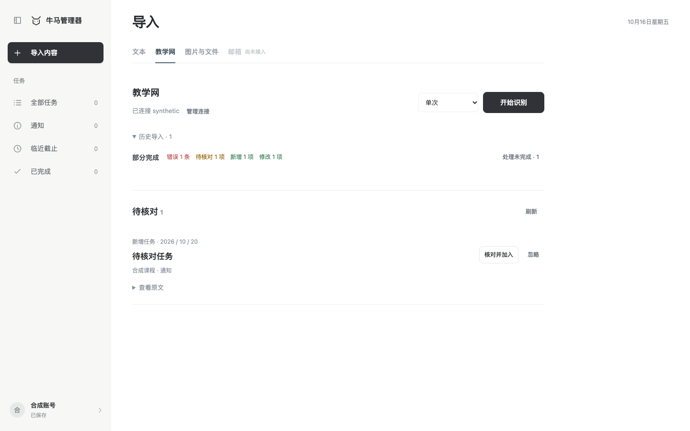
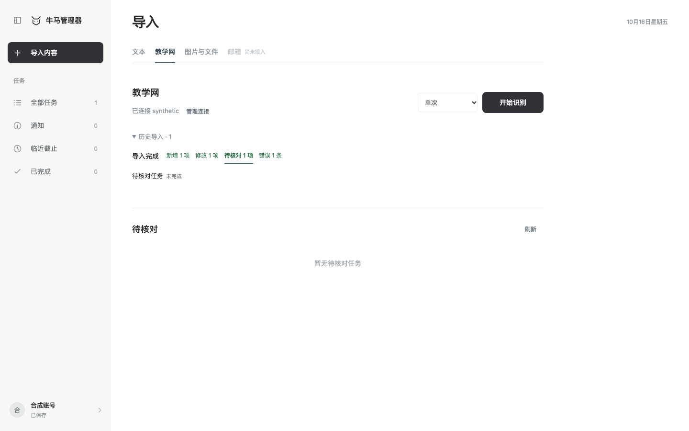
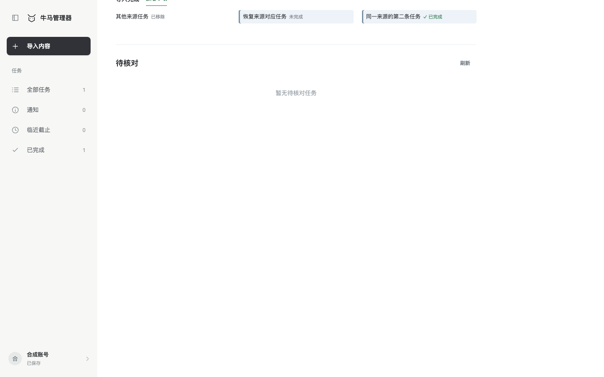
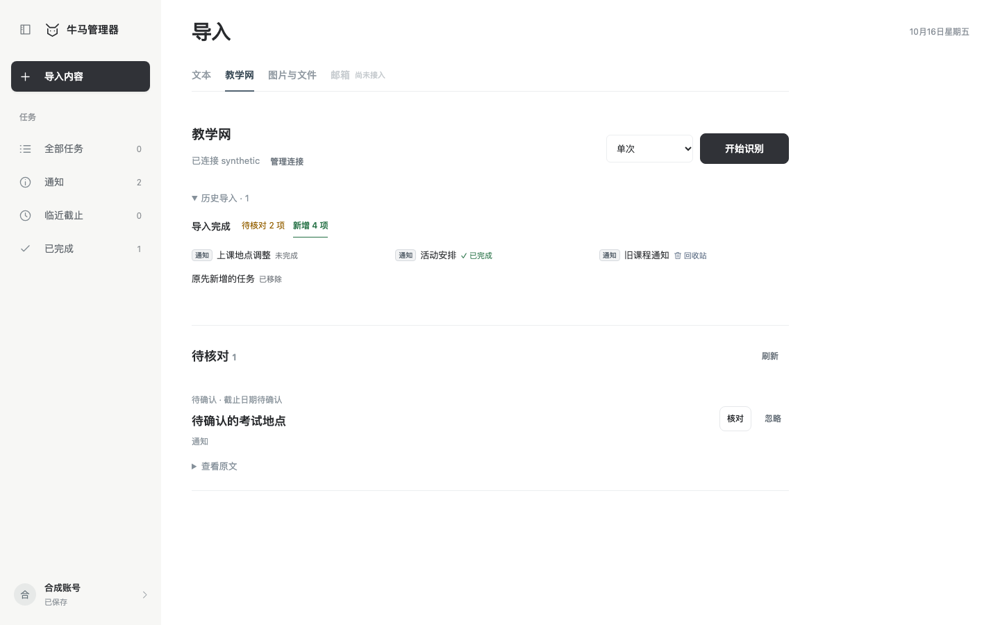

# 前端维护指南

## 模块职责

| 模块 | 职责 |
| --- | --- |
| `app.js` | 统一 `.page-frame`、页面和查询状态、任务操作、日历导航、抽屉与焦点协调 |
| `page-layout.js` | `renderPageHeading` 只渲染单行标题、`controls` 与 `actions`，统一标题行与首控件起点 |
| `task-model.js` | 本地日期、截止排序、范围及组合筛选、日期分组 |
| `course-identity.js` / `course-identity.css` | 规范化课程身份、账号范围配色偏好、课程签、简称与色点 |
| `task-views.js` | 清单任务行、截止分组、当日及无日期任务面板 |
| `calendar.js` / `calendar.css` | 月历、周截止日程及任务组件样式 |
| `calendar-activity.js` | 按截止日与实际完成日聚合任务数量，固定色阶与日期记录筛选 |
| `calendar-drag.js` | 任务分配日期与改期的鼠标手势、日期落点预览和取消 |
| `task-drawer.js` / `task-evidence.js` | 任务详情、编辑字段、原文与证据链接 |
| `import-ui.js` | 文本通知、教学网连接与采集、候选确认和失败重试 |
| `import-evidence.js` | 候选摘录、完整原文、安全来源链接和失败来源身份 |
| `import-result-status.js` | 从当前任务 / 回收站与候选映射历史状态，复用回收站图标 |
| `source-schedule-ui.js` | 单次 / 定时统一启动、停止后保留频率、明确授权 |
| `materials-ui.js` | 文件选择、持久作业、幂等重试与历史记录 |
| `source-sync-ui.js` | 后台同步、分类名称列表、有效结果历史、最近检查、停止与逐条 / 批量重试 |
| `account-ui.js` | 登录、验证码注册、邮箱补验证、密码找回、退出、昵称、密码表单及教学网连接入口 |
| `user-errors.js` | 用户错误分类、统一反馈控件、确认回执及同一问题重试 |
| `error-reports-view.js` | 管理员错误报告展示，不加载到普通页面 |
| `usage-feedback.js` | 账号中的主动反馈、按账号与北京时间日期去重的访问及非阻塞评分 |
| `review-tasks.js` / `candidate-data.js` | 待核对清单投影、日期显示与变更关联；用户完成或编辑通过候选接口原子确认 |
| `admin-usage.js` / `admin-usage.css` | 管理员独立入口的统计、日期筛选、反馈与手机布局 |
| `team-store.js` | 同源 API、任务与回收站状态、账号请求隔离、保存队列与冲突处理 |
| `demo.js` | 不持久化、不提交识别的合成任务预览 |
| `theme.css` | 普通应用与独立后台共用的颜色、控件圆角和页面尺寸变量 |
| `assets/brand-logo.webp` / `assets/mascot-peek.png` | 主站与后台共用品牌图标及侧栏底部探头形象 |
| `favicon.svg` | 嵌入同一品牌图的主站与后台标签页图标 |
| `styles.css` | 共用页面与阅读区坐标、侧栏、查询控件、表单与弹窗 |
| `icons.js` / `id.js` / `environment-badge.js` | 当前入口使用的图标、浏览器兼容 ID、环境和版本描述 |

普通界面提供文本、教学网、图片与文件导入、任务与通知管理及月周截止日历；邮箱保持禁用占位。后台使用独立入口，不加载进普通页面。新增功能应先更新 [产品规格](design.md)。

## 数据与边界

网页通过同源 `/api` 调用服务端，开发代理默认指向 `127.0.0.1:1332`。真实工作区保存到登录账号的服务端存储；浏览器保留会话 Cookie 和界面偏好，不保存工作区、密码或模型密钥。

`course-identity.js` 共用 `courseIdentity`、`renderCourseBadge`、`renderCourseDot` 与 `syncCourseColors`，由页面按当前账号范围同步课程，再供清单、日历、详情和筛选复用。课程名先规范化再计算稳定哈希；视觉偏好仅保存课程哈希和 8 色索引，账号范围也以哈希分桶，不写课程原文或任务。保留已有分配，新课优先选空余色，超过 8 门可复用；存储读取或写入失败不阻断页面。课程色不加入后端契约，不改变课程筛选条件、任务排序和状态含义。

`course-identity.css` 维护浅底深字课程签、紧凑课程简称与色点，未分类使用中性灰；长名可截断但完整名称保留在提示和可访问文本中。日历摘要沿用相同色号，手机月历只追加最多 3 个去重课程点，日期格触控范围、容器高度与首屏完整月份保持原规则。

邮箱注册与补验证遵循 [email-auth/0.1](../../contracts/docs/email-auth-v0.1.md)：注册透传 `challengeId/code`，补验证只更新当前 `session.user`，不触发账号切换或刷新工作区；发码结果按账号、表单和操作版本丢弃迟到响应。密码与验证码只保留在当前表单中，修改邮箱时失效原挑战；倒计时不是后端限流的替代。`tests/browser/email-verification.spec.js` 覆盖桌面和窄屏的注册、补验证、失败重试及关闭/退出竞态。

找回密码使用 `purpose=reset_password`，挑战同时绑定表单用途和邮箱，不能复用注册或补验证挑战。提交 `{email,challengeId,code,newPassword}` 成功后仅返回登录面板，不自动登录或改写已登录账号的工作区；邮箱资格不从发码响应推断。后台撤销所有旧会话，当前浏览器再次使用时由原鉴权流程处理过期状态。

客户端工作区只有 `tasks` 与 `trash`；任务使用字符串 ID、`due: YYYY-MM-DD`、可选 `dueTime: HH:MM` 和 `status: todo | doing | done`。`team-store.js` 只缓存任务与其版本，保存只写任务，不保存 `courses` 或 `materials`；导入核对通过 `getTaskVersion()` 读取任务版本。账号昵称使用服务端的 `name` 字段。编辑表单保存前校验打开时的可编辑字段，目标被删除或内容已变化时保留草稿并提示重新核对；状态等独立变化不阻止编辑。日历只读取未完成任务的截止日期，不维护 `schedule`、学习时段日期转换、估时、子任务编辑或依赖关系恢复等旧界面适配，也不包含历史任务迁移。

服务端任务 PUT 仍要求 `plans`、`subtasks` 为数组；新任务使用空数组，已有任务字段直接透传，不重新构造对应内容。来源证据通过 `task-evidence.js` 的接口读取；删除、撤销与恢复通过任务保存接口更新回收站标记。

通知读取同一 `tasks` 数组中的 `content_type=notice`，缺少该字段的旧记录沿用 task。侧栏顺序为全部任务、通知、临近截止、已完成；全部任务清单只包含未完成任务，通知入口包含全部通知。临近截止包含有近期日期的未完成任务及未阅读通知，已完成包含已完成任务及已阅读通知。阅读复用现有 `status`：客户端 done / 服务端 completed 表示已阅读，恢复未阅读保存 todo / not_started；`completedAt` 沿用完成时间，历史 completed 通知直接呈现已阅读，不批量改写数据。列表按钮、详情复选框和日历当日面板共用保存及撤销逻辑，通知采用“已阅读／未阅读”措辞和勾选，不加任务删除线。日历继续包含未完成任务和全部通知。候选创建采用候选类型，更新采用目标类型，沿用既有接口字段；编辑表单允许选择任务或通知类型。

任务日期只有天时不能补造 23:59；只有时刻而没有日期的输入不能保存。文本中的“今天”“明天”按通知发布时间理解，导入时间使用明确的上海时区信息。候选更新、延期或取消已有任务需要核对目标任务及版本。

通知页复用 `task-model.js` 的 `sortTasks` 按关键日期、时刻升序展示：同日缺少时刻随后、无有效日期最后、相同时刻按 ID 稳定排序；筛选和阅读状态更新不改变规则，不向服务端保存展示顺序。

任务界面的“今天”按浏览器本地日期计算，跨日或页面回到前台时更新顶栏、日期分组、临近截止范围及只读详情；保留筛选、日历位置和任务编辑草稿，导入页只更新日期，不替换导入或核对表单。完成及阅读操作使用操作当天的日期，不沿用打开页面时的日期。

教学网同步调用 `/api/sources/sync-runs`，后台负责并发识别和明确任务入库，前端不循环派发识别或自动加入草稿。先等待任务保存；运行进度变化后刷新任务及候选，两者都成功才记录已消费版本，失败可重读相同进度。历史只显示新增任务或通知、待核对、任务更新及错误；服务端按凭据范围、稳定来源身份和错误类型合并重复异常，再取最近 20 条。同类已恢复异常只保留最新一条，并通过 `recovered_by` 指向成功批次；较旧混合记录保留真实产出，不重复展示已隐藏的异常；原始回执供恢复和幂等使用，不因列表过滤删除。点击数量切换本轮分类，紧凑网格列出真实名称，不再使用“处理详情”及逐条卡片。新增 / 更新用任务身份打开抽屉，待核对用候选存储身份打开原核对窗口，错误点名称显示原因及重试；分类状态和按钮焦点在重绘时保留。`counts.review / updated`、`record.added_items / review_items` 和 `updated_tasks` 来自服务端实际结果，不能把识别成功数当作新增数。无变化运行由列表省略，`last_check` 更新最近检查；只有本页面主动开始的检查无变化时临时提示，恢复页面或定时检查不重复提示。离开页面暂停轮询，返回恢复持久化运行；停止通过服务端 stop 接口，统一“处理未完成”只提交最新异常的 request_id：纯识别失败使用 retry，缺少来源或来源变化使用 recover。后端在注册来源及读取附件之前按稳定 input_id 限定异常范围，成功项、正常待核对项和无关新内容不重复处理；替换快照成功后精确恢复旧异常，仍不完整则继续保留。

`import-result-status.js` 按任务 ID、候选存储 ID 读取当前 `tasks / trash`，并通过 `team-store.readCancelledTasks()` 读取账号内已取消任务的独立副本，显示完成、未完成、已取消、已移除、待核对、已忽略、错误、已恢复及“回收站”标记；通知在名称前复用小号 `notice-label`，后方按同一完成状态显示；已恢复条目及链接显示灰色，分类只显示名称与历史数量；错误全未恢复为红、部分恢复为黄、全部恢复为绿，待核对在全部确认或忽略后由黄变绿，新增与修改为绿。`importCategorySummaries` 共用于同步和独立历史，顺序为未解决错误、仍待核对、新增、修改、已处理核对、已恢复错误，重排保留分类选择；未知旧核对状态保持黄色，进度通过 title / aria-description 提供；不修改历史回执数量。识别候选兼容增加只读 `autoApplied`，独立历史中的人工核对回执不因确认而转入新增分类。`recovered_by` 由账号及凭据范围内的稳定来源、精确快照替换链计算，旧映射只读补全。恢复定位高亮与保留目标批次的导航状态分别管理：`recoveryHighlight` 保存目标分类内全部关联身份，`cancelRecoveryNavigation` 只取消迟到定位，`dismissRecoveryHighlight` 同时清除高亮。首项在视口顶部留 24px，页尾按实际内容补足临时滚动空间；高亮不追加可见文案或计时器，在滚动、键盘浏览和重绘后保留，切换分类、定位其他结果、收起历史、切换来源或离开页面时清除，并释放滚动空间；账号切换丢弃旧响应。界面实例见下方合成数据截图。

无逐条记录的整轮采集错误使用运行级 `recovered_by: {run_id}` 保留恢复关联与原始错误。后端仅在相同账号、凭据和来源范围的完整采集确认完成后持久标记；包含无变化检查，也独立于后续模型识别成败。内部 `collection_completed` 不对客户端暴露，重试与局部补采不用于清除整轮错误；旧回执在初始化清理无变化记录前按可证实的完整采集补全。恢复后的批次保留历史入口，隐藏过时错误指引及重复处理操作；恢复目标不存在时明确提示对应记录无法查看、已保存任务不受影响，不从 404 推断“已归档”。










教学网主按钮统一启动与停止，活动运行期间频率选择保持禁用，主按钮仍可停止；`import-ui.js` 在关闭定时服务和停止当前运行的整个过程保持停止锁，失败恢复可操作状态，账号切换后不得继续提交旧操作。`source-sync-ui.js` 提供当前运行停止方法及 `progressLabel()`，阶段和计数由按钮 title、aria-describedby 与屏幕阅读器 status 展示。`source-schedule-ui.js` 只在启动、实际运行或停止期间显示按钮内沿圆角方形路径移动的短线，使用 SVG 描边虚线偏移，中心停止方块保持静止，定时等待与静默轮询不触发；停止图标仍表示同一个可点击动作，停止请求期间按钮禁用。没有真实结果时不输出独立进度容器和直线条，已有结果和读取错误仍可查看。`prefers-reduced-motion` 下短线保持静态。

进度读取期间若页面已显示禁用控件，读取结束后即使进度不变也重绘解除禁用；无人渲染的无变化轮询保持静默，不重复刷新任务或打断表单。

前端不提供已有通知的批量重新识别入口，不加载对应组件或轮询；后端接口保留，常规同步与失败重试继续可用。

`recognition/batches.sourceSyncManaged` 由服务端按当前账号的完整同步回执和导入元数据计算，不依赖去重后的可见历史或 20 条分页。前端据此同时阻止独立历史展示与旧重试路由重复处理；已有同步结果与独立识别批次只使用一个历史容器，独立结果按 importId 合并，切换分类查看紧凑名称及错误详情，来源切换不混入其他来源历史。未关联后台运行的旧保存批次仍使用既有身份重试接口；该接口只生成候选，前端对其初始明确新增项调用已有 `auto_apply:true`，最终资格由后端判断。后台运行覆盖的批次不再提供这条重试入口，避免重复派发。人工核对不再提供 reviewed 勾选框，由确认表单提交发送既有 `reviewed:true`；目标任务、候选版本和任务版本校验保留。

账号切换或退出时清理查询、编辑、候选、连接信息和撤销上下文；取消旧请求或丢弃旧账号迟到的响应。刷新等待保存队列稳定后读取，读取期间有新修改则保存后重读，迟到响应不得回退任务版本；旧列表中缺少的记录只通过显式回收操作删除。撤销完成按当前任务 ID 恢复状态，避免刷新后操作旧对象。删除与恢复失败时保留待重试操作，重试后刷新列表；重新读取或切换账号会清除旧操作，普通编辑可在原表单再次保存。保存失败要显示错误并提供明确重试路径，不能把未保存的数据标成成功，也不能因重试产生重复任务。

`navigation.js` 只读写页面、任务分类、视图、日历日期及导入来源等允许的导航字段；`app.js` 在用户导航时更新历史，在启动及 `popstate` 时恢复并规范化参数。网址明确指定的视图优先于本地偏好，旧链接缺省字段使用原有默认值；保留 `demo` 等其他参数。账号重置保留安全导航位置，但清理查询、表单、凭据与旧响应。导入来源由 host 同步到 `import-ui.js`，恢复导入页后按当前账号读取结果；不得把通知正文、搜索条件或未提交表单写入网址。

账号弹窗的教学网管理栏使用已有 `data-import-action="credentials"`；`import-ui.js` 在连接状态尚未读取时按需获取，检查账号版本和发起入口是否仍在打开的窗口内，再复用连接管理表单；关闭窗口和切换账号后丢弃迟到的打开动作。

核对重读期间锁定当前表单，返回结果前校验仍为同一份核对及仍打开的窗口；关闭或切换窗口后，旧请求不得重新打开旧核对。候选确认、连接管理、昵称及密码保存可以继续完成，但只关闭发起操作的原窗口，不能误关后来打开的草稿。

`demo=1` 仅使用合成内存状态，禁止提交其文本或任务到识别、采集或账号保存接口。可查询公开环境信息；合成任务在刷新后重置。

`usage-feedback.js` 与普通页面共用 `team-store.js` 的账号和 API，不恢复旧 store 适配；会话读取成功后触发 `niuma:session-ready`，反馈失败不影响任务读写。主动反馈位于账号弹窗，评分浮层不替换任务编辑器；独立后台继续使用自己的权限校验与构建入口。

清单查询区与日历分开：日历不渲染查询区，也不继承清单过滤条件，返回清单恢复原条件。月历通过 `--calendar-weeks` 标明 4–6 行，在剩余视口高度内均分行高，并按日期格容器高度缩为首条摘要或总数，完整内容保留在当天详情中。

月、周日历的日期格、当日及无日期面板为未完成任务提供 `data-calendar-drag-task`，日期格共用 `data-calendar-drop-date` 接收鼠标落点；预览按原文字中的相对抓取点定位，让鼠标覆盖标题，辅助区域起拖使用标题中心。`calendar-drag.js` 以 6px 移动区分点击，拖放后拦截合成点击，Esc、取消、失焦及重绘清理指针捕获和预览；触屏不接管滚动。`app.js` 共用日期保存与撤销流程，改期保留原 `dueTime`，拖回原日期不提交；保存成功后更新选中日期并提供撤销，`team-store.js` 的 `setStoredTaskDeadline` 串行检查目标日期快照，只改截止字段并透传其他元数据，失败不保留待重试变更，409 冲突要求重读；不得调用普通快照保存把失败拖放留在队列中。

新增系统错误入口必须使用 `userErrorMarkup`，由共用点击处理提交报告；不得直接显示原始异常或自行新增上报请求。普通校验保持就地更正。同步修改错误分类时，核对 `contracts/schemas/error-report-v0.1.schema.json`；新增或变动入口须补充浏览器回归场景，检查实际可见与可点击，不能只检查字符串存在。报告提交不调用整页重绘，保留编辑草稿；账号切换清理客户端报告状态。

## 开发与验证

按 [小组协作规范](../../CONTRIBUTING.md) 建立分支。界面与浏览器交互保留在 `frontend/`，服务端契约变更由相应模块负责人审查。启动和环境选择见 [README](../README.md)；共享测试和生产使用[环境隔离入口](../../server/deploy/ENVIRONMENTS.md)，不共用数据库、凭据或数据卷。

新页面必须共用 `app.js` 的 `workspaceHeading` 与 `.page-frame`（最大宽度 1450px）。`workspaceHeading` 为 `renderPageHeading` 注入导航与日期，导入模块通过 host 使用同一入口；桌面正式标题与右侧操作、日期共处首行，添加按钮在日期左侧。手机首行容纳导航、操作与日期，标题和视图切换在次行。不得恢复浅色辅助标注或独立的顶部占位行。清单与日历使用框架内可用宽度，导入正文使用左对齐的 `.page-reading`（最大宽度 860px）；不能另设居中或限宽的页面外框。

`theme.css` 由 `styles.css` 与 `admin-usage.css` 引入，统一维护纯白底色、珊瑚桃色操作、品牌深棕与按钮文字、日期雾蓝和控件圆角；主操作、悬停、按下、浅底、边框与焦点颜色成组维护，普通按钮按下与账号入口悬停复用主题变量，状态颜色保持原有语义。`styles.css` 维护页面、日历布局、当日面板分隔线和内边距；`calendar.css` 维护日历与任务组件样式，避免重复声明被页面布局覆盖的边框与间距。

`app.js` 与 `admin-usage.js` 通过 `new URL(..., import.meta.url)` 打包同一 `src/assets/brand-logo.webp`，分别用于主站品牌区、后台顶栏与后台登录；图像来自确认稿的白边裁切与缩小，保留空心勾选牛角、点与直线进度嘴及左上、右下扫描角。`favicon.svg` 嵌入同一图片，不依赖外部资源。主站品牌图固定为 36×32px，窄桌面侧栏为 32×28px，保留图片的实际比例并避免拉伸。

侧栏底部继续打包透明的 `assets/mascot-peek.png`；品牌图与探头使用空 `alt`、`aria-hidden` 和预留尺寸，品牌名称承担可访问名称。底部插画在折叠栏、700px 及以下手机宽度和 720px 及以下窗口高度隐藏，不增加正文插画或挤占导航入口。

在 `frontend/` 运行：

```bash
npm test
npm run build
```

`npm test` 仅运行前端测试，不安装后端测试依赖或执行服务端测试；CI 的 app 作业单独安装 `server/requirements-test.txt` 并运行全部后端单元测试。后端与采集器分别按各自模块说明验证。前端行为测试覆盖：

- `course-identity.test.js`：颜色分配与追加稳定、刷新恢复、账号隔离、存储不可用、超出色盘、课程名规范化及安全标记。
- `course-calendar.test.js`：月周课程身份一致、日期课程点去重与最多 3 个、完整课程辅助名称、安全转义及原摘要过滤规则。
- `task-model.test.js`：组合筛选、分组边界、闰月和跨年、月格摘要、安全渲染、临近截止与已完成的任务／通知混合范围，以及详情、列表与日历面板的阅读状态。
- `app-date.test.js`：跨日自动更新、休眠后操作的完成及阅读日期、前台恢复、日历跳回今天，以及筛选和未提交草稿保留；启动恢复任务分类与导入来源、日历导航写入网址、浏览器前进后退及账号重置清理草稿。
- `navigation.test.js`：导航参数往返、旧链接与本地偏好优先级、无效日期与参数回退、示例参数保留及私有内容不写入网址。
- `calendar-drag.test.js`：点击与拖动阈值、抓取点随指针移动、日期格与当日 / 无日期面板共用落点、拖出取消、Esc / 取消 / 失焦 / 重绘、点击拦截、触屏与通知边界；`app-date.test.js` 补充日期分配与改期、时刻保留、同日不保存、失败留在原位和撤销。
- `tests/browser/account-calendar.spec.js`：首次从账号入口读取教学网连接、更新 / 移除 / 重连、关闭期间迟到响应，以及真实鼠标在月周日期格和当日面板改期、时刻保留与撤销；账号栏检查桌面、390px 和 320px。

- `user-errors.test.js`：用户提示、未知错误兜底、反馈状态、丢失回执重试与字段限制；`tests/browser/error-feedback.spec.js` 用合成 API 检查真实错误区和按钮可见、可点击，覆盖桌面及手机、弹窗和失败重试。
- `import-flow.test.js`：通知时间、日期精度、候选版本、刷新与后台结果交错、教学网采集、账号切换和合成预览边界。
- `import-auto.test.js`：后台导入集成、任务刷新、保存保护、停止与账号切换。
- `import-evidence.test.js`：摘录和全文同时可读、失败来源身份及安全链接。
- `source-schedule.test.js`：单次与定时切换、明确授权、停止、冲突、重复点击和账号隔离。
- `materials.test.js`：文件回执、稳定重试、结果刷新与重试耗尽。
- `source-sync.test.js`：后台运行、失败重试、刷新恢复、幂等和账号隔离，以及分类切换、真实结果身份、名称与计数校验、有效结果过滤、更新回执、无变化检查与单次提示。
- `team-store.test.js`：任务保存、通知阅读与取消阅读的持久化、接口要求的字段透传、账号隔离、冲突重试、刷新与保存交错、迟到版本保护及删除恢复；月历日期赋值与撤销、失败不重放、过期日期检查和版本冲突。
- `usage-feedback.test.js`：主动反馈入口、每日访问去重、跨北京时间日期、只读会话恢复、键盘使用和失败重试，以及后台入口隔离；`tests/browser/usage-rating.spec.js` 验证同排配色、可修改评分、快速选择顺序、反馈草稿与重试、动画及 1.5 秒内自动收起。
- `task-evidence.test.js`：来源 URL 校验、原文和证据摘录。
- `environment-badge.test.js`：服务环境、版本差异及本地构建标识。

界面验收检查 1440px 桌面、390px 与 320px 手机：清单组合筛选正常，日历不受隐藏条件限制，切回清单恢复条件；全部任务标题右侧的清单 / 日历双段开关保持标题对齐，日历省略查询区并优先在首屏显示完整的 4–6 行月份；当日及无日期详情仍可访问；进入临近截止或已完成固定显示清单，返回后保留原日历上下文；月份和周范围可跨年；保存、完成和恢复后焦点合理；桌面固定收放按钮和 72px 图标栏可用，折叠入口可直接点击，悬停约 500ms 与键盘焦点都显示名称；手机仍使用抽屉菜单，可关闭且焦点不会进入遮罩后的页面；长任务名、空结果和错误状态可读。另检查同一课程在清单、当日面板、月周日历、详情与已选课程筛选中颜色一致，新增课程和刷新不重分配已有配色，长名、未分类与超过 8 门课程可读；手机月历色点不挤占日期与数量。另检查折叠、手机与 720px 及以下矮窗口隐藏底部插画，图片加载前后不移动导航或账号位置；完成勾选的悬停与禁用状态保持可辨。关键触控操作至少提供 44px 有效点击高度。

不要提交依赖、构建产物、日志、数据库、账号材料、密钥或本地配置。验证截图使用合成材料。

## 文档规则

`README.md` 提供目录、启动和验证入口，`design.md` 描述当前产品规格，`CONTRIBUTIONS.md` 保留历史贡献和设计参考。历史资料位于 `docs/archive/`，不能据此宣称当前仍有相应入口。文档不记录临时阶段进度；功能变化应直接更新当前规格和对应验证要求。

`tests/review-tasks.test.js` 与 `tests/browser/review-task-list.spec.js` 验证待核对混排、搜索筛选、忽略撤销、普通完成与编辑确认、失败保留和重新打开；服务端 `test_review_task_actions.py` 验证原子完成、幂等、版本冲突、账号隔离及事务回滚。

`account-avatar.js` 只接受本地 JPG/PNG/WebP，限制 5 MB、最长边 8192px 与 2000 万像素；裁切为 256×256 PNG 后交给 [头像接口](../../contracts/docs/account-avatar.md)。账号与侧栏只展示服务端返回的 PNG data URL，不读取外部头像地址；文件解码校验账号版本、选择序号和原表单是否仍打开。保存串行发送，每次成功响应更新对应已保存头像，关闭后的成功响应只更新同一账号的头像，不能关闭新表单或覆盖其他资料；账号切换丢弃旧响应。`tests/browser/account-avatar.spec.js` 覆盖桌面、390px、320px 下的悬停/键盘/触屏入口、裁切保存与刷新、取消/恢复默认、失败重试和关闭期间迟到响应。

账号面板仅提供通用环境工具插槽；`/api/version` 在显式 development/test 且工具源码存在时返回固定同源模块地址，独立 UI 脚本放在 `server/environment_tools/` 随测试工具挂载，不静态导入前端源码或打包到正式网页。清空确认绑定账号及操作版本，等待已有保存结束后丢弃失败草稿，后台成功才刷新；切换账号丢弃迟到结果。
