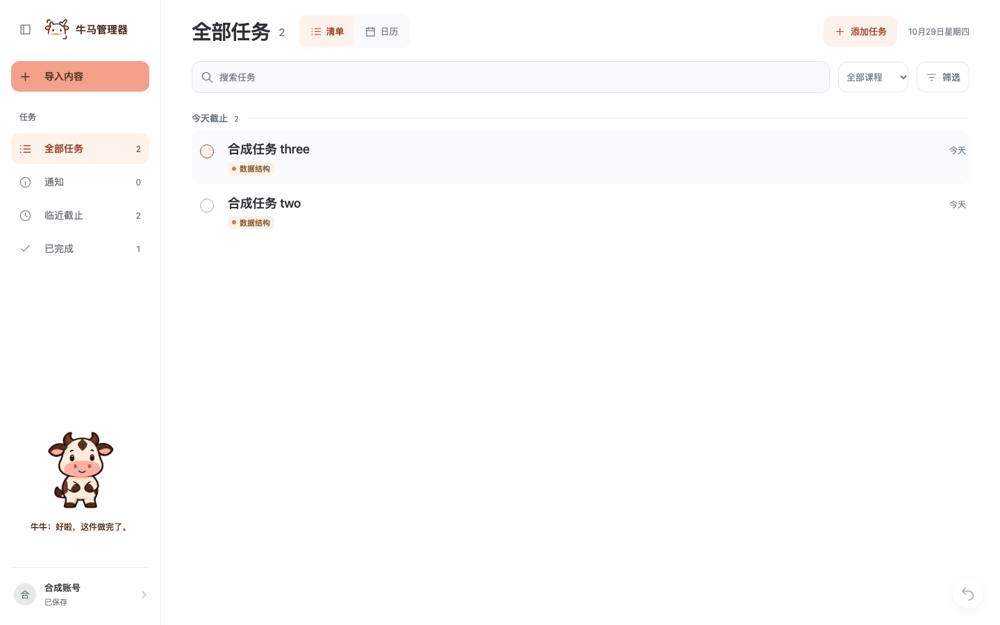
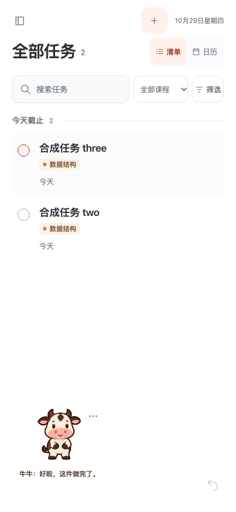
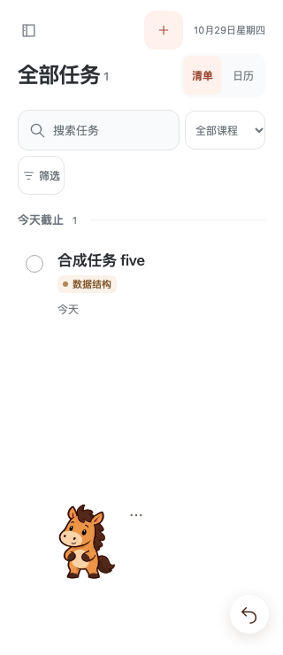

# 牛马伙伴

牛牛温和稳当，用日常短话肯定完成，例如“好啦，这件做完了。”；马马说话利落，例如“行，这件搞定。”，偶尔提醒剩余任务，不把每次反馈都写成问句。两者不责备、不比较、不凭空断言任务艰巨、超额或用户情绪；清单完成时改说收工与休息。

每次只出现一只，沿用奶油白牛、焦糖棕马、深棕轮廓及圆润蹄形。牛牛保留短角、额头水滴斑和宽粉鼻口，马马保留竖耳、三撮鬃毛和长奶油鼻口。

## 位置与动作

一个常驻伙伴同时承接心情与完成反馈：默认左下角，短句话语位于角色正下方，不再使用中央完成卡或静态双头像。桌面落在侧栏账号上方，手机正常页面也可见；点击选项可回到左下角、暂停动作或关闭伙伴。

`src/assets/companions/pet-v3/` 保存牛马各一套动作图集与一套常态/进出场图集，共64帧；每张为4×4格，连续帧保持比例、轮廓与脚底基线。`companion-motion.js` 定义播放序列和可取消的时间线。原姿势素材用于加载失败时的静态回退。

完成动作包含连续的抬蹄、合蹄或勾清单、收手和回落，耳尾与重心随动作变化；常态只有低频眨眼与细微动作。完成反馈到时，同一角色收好动作并淡出话语，保持留场；角色不同则先收尾离场，再由当前状态对应角色入场落稳。新的完成、关闭动画、隐藏页面与账号切换能打断旧流程，旧计时不再重绘。

取消自动视线跟随：普通鼠标移动不改变表情或方向，悬停约350ms只显示话语，点击才触发明显动作。拖动松手停在最近的左右边缘；方向键移动，Home复位，Escape收起话语。系统减少动态时直接保留静态角色与文字，不执行换场移动。

## 完成与撤回

只有手动完成保存成功后才触发反馈；2 秒内连续完成合并数量与文案，普通显示约 7 秒，悬停、聚焦与隐藏标签页时暂停计时。通知阅读、重新打开、后台同步和保存失败不庆祝。详情内完成时先保留状态，在展示期限内关闭详情后播放；编辑、账号弹窗和手机导航优先，伙伴暂时隐藏。

完成、重新打开、改期、删除及候选操作的撤回统一为右下角 44px 圆形图标按钮，悬停或聚焦显示操作说明；连续操作只撤回最近一次。约 7 秒后收起，悬停、聚焦、隐藏标签页时暂停；账号切换清除旧操作。详情内的按钮进入同一弹窗层，避开固定底部操作条；关闭伙伴仍保留撤回能力。

账号内可分别控制显示伙伴与小动画，伙伴选项同步这两个偏好；浏览器只保存布尔偏好，不保存任务内容。

## 状态判断

伙伴使用账号全部已保存任务，状态不随搜索和筛选变化；乐观保存草稿、通知、回收站、取消和待核对候选不计入。

| 条件 | 角色与语气 |
| --- | --- |
| 至少 3 项逾期 | 小马持清单，认真提醒先收尾一项 |
| 1–2 项逾期 | 小马轻声提醒 |
| 无逾期且今日完成至少 3 项 | 小牛庆祝，肯定今天的完成 |
| 无逾期且今日完成 1–2 项 | 小牛肯定小进步 |
| 其他情况 | 小牛安静陪伴 |

逾期沿用有效截止日早于今天的判断，完成按有效 `completedAt` 日期；没有每日目标，不声称“超额”或“又多了”。完成事件临时覆盖心情角色，结束后回到当前已保存状态。

## 界面示例

以下截图来自真实前端与隔离的合成 API，未使用真实账号资料。

设计参考：[OpenAI Pets](https://learn.chatgpt.com/docs/pets) 的分状态精灵动画、拖动与减少动态；任务心情、目光跟随与角色话语为本产品设计。
