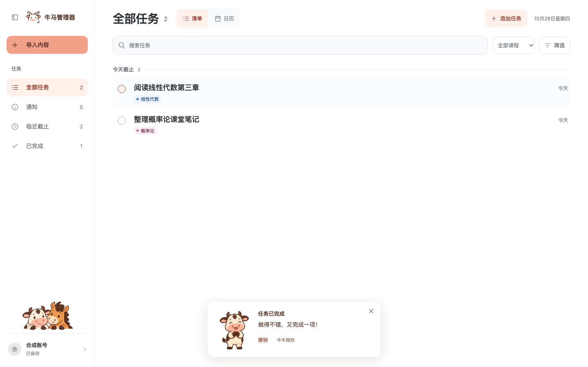
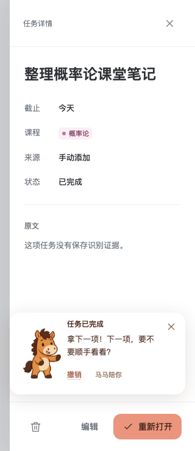

# 牛马完成伙伴

牛牛温和稳当，认真肯定刚刚完成的事，偶尔带一点冷幽默；典型话语是“做得不错，又完成一项！”，不凭空断言任务艰巨、耗时或用户情绪。

马马外放坦率，先认可完成，再像熟悉的朋友轻松邀约下一步；典型话语是“拿下一项！下一项，要不要顺手看看？”，不责备、不比较、不以休息制造负担。没有未完成任务时，两只都改说收工与休息。

两者是平等的老朋友，每次只出现一只，采用奶油白牛、焦糖棕马、深棕轮廓及圆润蹄形；牛牛保留短角、额头水滴斑和宽粉鼻口，马马保留竖耳、三撮鬃毛和长奶油鼻口。

## 动作素材

`src/assets/companions/` 保存 8 张 256×256 透明无损 WebP，角色共用以下文件名后缀。

| 后缀 | 牛牛 | 马马 |
| --- | --- | --- |
| `arrive` | 友善迎接 | 精神饱满地迎接 |
| `celebrate` | 合蹄庆祝 | 抬蹄认可 |
| `settle` | 安心肯定 | 邀请看看下一项 |
| `wave` | 满足挥手 | 开心收工 |

这些素材是独立关键姿势，不是连续逐帧动画；当前界面按情境选一张，播放一次轻点头或前倾后静止，减少动态时保留静态图。后续制作完整动画时，应补画中间帧或建立骨骼，而不是高速轮播姿势图。

`dialogue-bank.json` 提供 36 条普通完成、连续完成和全部完成文案；实际任务数量决定反馈类别，不把任务正文或账号资料写入视觉偏好。

## 交互

完成操作保存成功后才出现反馈，2 秒内连续完成合并，普通显示约 7 秒，悬停或键盘聚焦时暂停收起；合并提示明确只撤销最近一项。通知阅读、任务重新打开、后台同步与保存失败不触发庆祝。

账号内可分别关闭伙伴和小动画；浏览器仅保存两个布尔偏好，存储受限时仍可使用。反馈不抢焦点，在详情内保留可点击撤销，编辑和评分表单优先获得空间。

## 界面示例

以下为真实应用界面，数据由隔离的合成 API 提供。

