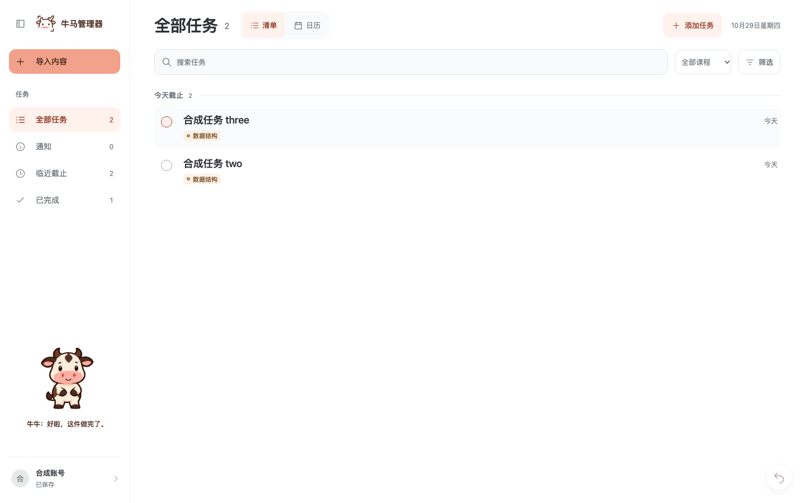
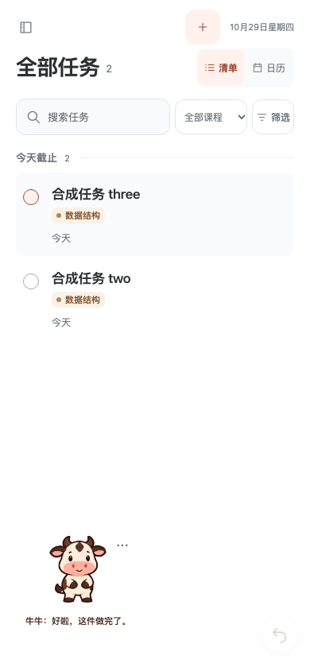
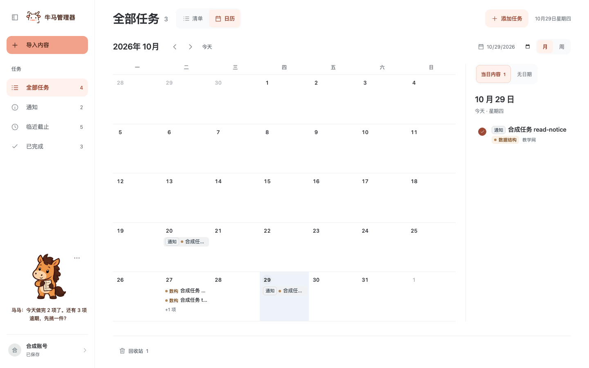
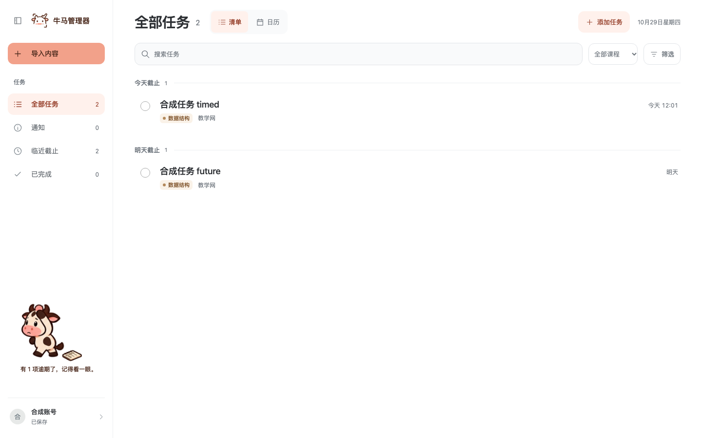
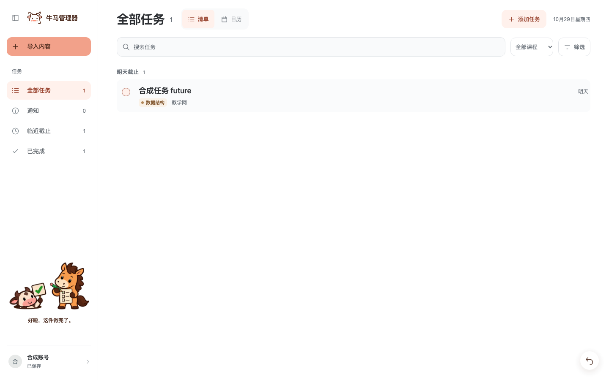

# 牛马伙伴

牛牛温和稳当，用日常短话肯定完成，例如“好啦，这件做完了。”；马马说话利落，例如“行，这件搞定。”，偶尔提醒剩余任务，不把每次反馈都写成问句。两者不责备、不比较、不凭空断言任务艰巨、超额或用户情绪；清单完成时改说收工与休息。

常驻时只出现一只，接班剧情中两者可同场；沿用奶油白牛、焦糖棕马、深棕轮廓及圆润蹄形。牛牛保留短角、额头水滴斑和宽粉鼻口，马马保留竖耳、三撮鬃毛和长奶油鼻口。

## 位置与动作

一个常驻伙伴同时承接心情与完成反馈：默认左下角，短句话语位于角色正下方，不再使用中央完成卡或静态双头像。桌面落在侧栏账号上方，手机正常页面也可见；点击选项可回到左下角、暂停动作或关闭伙伴。

角色由已保存任务的逾期状态决定：只要有逾期就留小马，没有逾期就留小牛。完成反馈由当前角色说话，不轮换角色，提示到时只收好动作和话语。初次读取直接显示正确角色；只有已知的有/无逾期之间发生变化时演接班剧情。

`src/assets/companions/pet-v4/` 保存两个48帧完整场景，每段3张4×4透明图集，单格512×384；`companion-motion.js` 定义约5–7秒的完整播放时序。`pet-v3/` 继续提供单角色的轻回应，原姿势素材用于加载失败的静态回退。

| 变化 | 完整剧情 |
| --- | --- |
| 小牛→小马，有了逾期 | 清单从右边飞来并砸到小牛，头顶起小包；小牛捂头向左走出，小马走近、弯腰捡起同一份清单，举起站稳。 |
| 小马→小牛，逾期清零 | 小牛从地面冒头，举勾选牌向小马晃；小马看见后用铅笔在纸上打勾，收好清单向左走出；小牛双蹄拉起身体、腿跨出洞口，站稳。 |

所有剧情动作均保留为真正绘制的连续画面，不以整图旋转或淡入淡出替代。普通任务更新不重启影片；期间只保留最新角色目标，完整演完当前剧情后再决定是否需要反向接班。账号重置、隐藏页面、关闭伙伴或系统减少动态可直接中止并采用正确静态角色。

取消自动视线跟随：普通鼠标移动不改变表情或方向，悬停约350ms只显示话语，点击才触发当前角色的短动作。拖动后靠边；方向键移动，Home复位，Escape收起话语。剧情与状态话语位于整个场景下方，结束后保留阅读时间。

## 完成与撤回

只有手动完成保存成功后才触发反馈；2 秒内连续完成合并数量与文案，普通显示约 7 秒，悬停、聚焦、完整接班剧情与隐藏标签页时暂停计时。通知阅读、重新打开、后台同步和保存失败不庆祝。详情内完成时先保留状态，在展示期限内关闭详情后播放；编辑、账号弹窗和手机导航优先，伙伴暂时隐藏。

完成、重新打开、改期、删除及候选操作的撤回统一为右下角 44px 圆形图标按钮，悬停或聚焦显示操作说明；连续操作只撤回最近一次。约 7 秒后收起，悬停、聚焦、完整接班剧情和隐藏标签页时暂停；账号切换清除旧操作。详情内的按钮进入同一弹窗层，避开固定底部操作条；关闭伙伴仍保留撤回能力。

账号内可分别控制显示伙伴与小动画，伙伴选项同步这两个偏好；浏览器只保存布尔偏好，不保存任务内容。

## 状态判断

伙伴使用账号全部已保存任务，状态不随搜索和筛选变化；乐观保存草稿、通知、回收站、取消和待核对候选不计入。

| 条件 | 角色与语气 |
| --- | --- |
| 至少 3 项逾期 | 小马持清单，认真提醒先收尾一项 |
| 1–2 项逾期 | 小马轻声提醒 |
| 无逾期且今日完成至少 3 项 | 小牛庆祝，肯定今天的完成 |
| 无逾期且今日完成 1–2 项 | 小牛肯定小进步 |
| 其他情况 | 小牛安静陪伴 |

逾期包括截止日早于今天，或今天已到有效的具体截止时刻；只有日期的任务等到次日才算逾期，最近的明确时刻会自动安排更新。完成按有效 `completedAt` 日期；没有每日目标，不声称“超额”或“又多了”。完成事件沿用同一角色，只有逾期状态的变化才接班。

## 界面示例

以下截图来自真实前端与隔离的合成 API，未使用真实账号资料。

设计参考：[OpenAI Pets](https://learn.chatgpt.com/docs/pets) 的分状态精灵动画、拖动与减少动态；逾期接班剧情、任务心情与角色话语为本产品设计。
