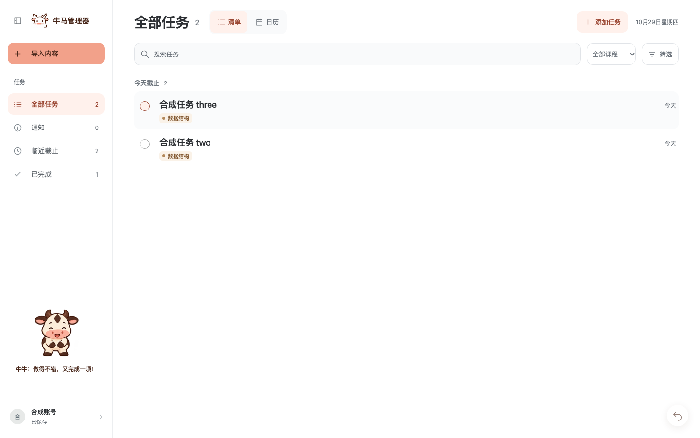
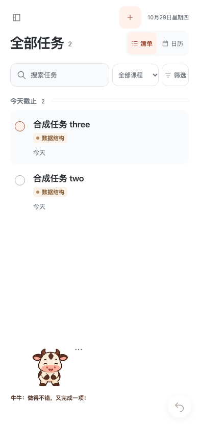
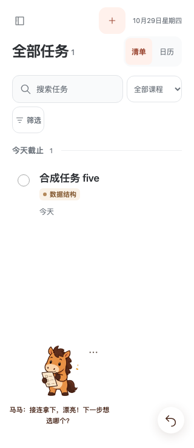

# 牛马伙伴

牛牛温和稳当，认真肯定刚刚完成的事；马马外放坦率，先认可，再像熟悉的朋友轻松邀请下一步。两者不责备、不比较、不凭空断言任务艰巨、超额或用户情绪；清单完成时改说收工与休息。

每次只出现一只，沿用奶油白牛、焦糖棕马、深棕轮廓及圆润蹄形。牛牛保留短角、额头水滴斑和宽粉鼻口，马马保留竖耳、三撮鬃毛和长奶油鼻口。

## 位置与动作

一个常驻伙伴同时承接心情与完成反馈：默认左下角，短句话语位于角色正下方，不再使用中央完成卡或静态双头像。桌面落在侧栏账号上方，手机正常页面也可见；点击选项可回到左下角、暂停动作或关闭伙伴。

`src/assets/companions/pet-v2/` 的两张 1536×1536 透明 WebP 图集各含 16 个 384×384 单元；`manifest.json` 记录格子和来源，`companion-motion.js` 定义播放序列。动作由表情、四肢与道具变化的独立帧组成，原姿势素材仅作为加载失败时的静态回退。

| 帧 | 内容 |
| --- | --- |
| 0–5 | 安静、眨眼、左看、右看、上看、下看 |
| 6–8 | 抬蹄招呼与回落 |
| 9–12 | 牛牛蓄力、交替抬脚、举蹄庆祝；马马查看清单、勾选、举蹄认可 |
| 13–15 | 被提起时收腿、落地压低、站稳 |

完成时播放约 1.4 秒动作后安定，空闲仅间歇眨眼；指针靠近时看向对应方向，悬停与点击有短回应。拖动松手停在最近的左右边缘，不追逐指针；方向键移动，Home 复位，Escape 收起话语。隐藏页面、覆盖面板及系统减少动态时停止动作帧；减少动态仍保留角色、话语和撤回。

## 完成与撤回

只有手动完成保存成功后才触发反馈；2 秒内连续完成合并数量与文案，普通显示约 7 秒，悬停、聚焦与隐藏标签页时暂停计时。通知阅读、重新打开、后台同步和保存失败不庆祝。详情内完成时先保留状态，在展示期限内关闭详情后播放；编辑、账号弹窗和手机导航优先，伙伴暂时隐藏。

完成、重新打开、改期、删除及候选操作的撤回统一为右下角 44px 圆形图标按钮，悬停或聚焦显示操作说明；连续操作只撤回最近一次。约 7 秒后收起，悬停、聚焦、隐藏标签页时暂停；账号切换清除旧操作。详情内的按钮进入同一弹窗层，避开固定底部操作条；关闭伙伴仍保留撤回能力。

账号内可分别控制显示伙伴与小动画，伙伴选项同步这两个偏好；浏览器只保存布尔偏好，不保存任务内容。

## 状态判断

伙伴使用账号全部已保存任务，状态不随搜索和筛选变化；乐观保存草稿、通知、回收站、取消和待核对候选不计入。

| 条件 | 角色与语气 |
| --- | --- |
| 至少 3 项逾期 | 小马持清单，认真提醒先收尾一项 |
| 1–2 项逾期 | 小马轻声提醒 |
| 无逾期且今日完成至少 3 项 | 小牛庆祝，肯定今天的完成 |
| 无逾期且今日完成 1–2 项 | 小牛肯定小进步 |
| 其他情况 | 小牛安静陪伴 |

逾期沿用有效截止日早于今天的判断，完成按有效 `completedAt` 日期；没有每日目标，不声称“超额”或“又多了”。完成事件临时覆盖心情角色，结束后回到当前已保存状态。

## 界面示例

以下截图来自真实前端与隔离的合成 API，未使用真实账号资料。

设计参考：[OpenAI Pets](https://learn.chatgpt.com/docs/pets) 的分状态精灵动画、拖动与减少动态；任务心情、目光跟随与角色话语为本产品设计。
