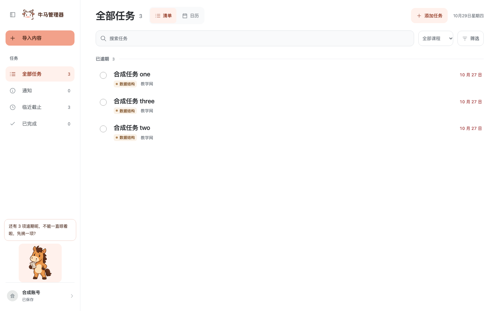
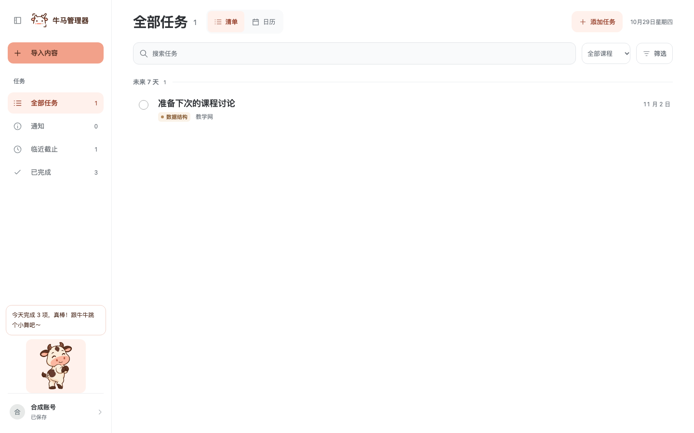
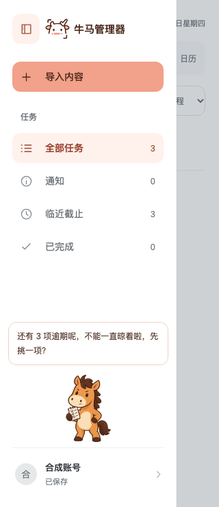

# 牛马伙伴

牛牛温和稳当，认真肯定刚刚完成的事，偶尔带一点冷幽默；典型话语是“做得不错，又完成一项！”，不凭空断言任务艰巨、耗时或用户情绪。

马马外放坦率，先认可完成，再像熟悉的朋友轻松邀约下一步；典型话语是“拿下一项！下一项，要不要顺手看看？”，不责备、不比较、不以休息制造负担。没有未完成任务时，两只都改说收工与休息。

两者是平等的老朋友，每次只出现一只，采用奶油白牛、焦糖棕马、深棕轮廓及圆润蹄形；牛牛保留短角、额头水滴斑和宽粉鼻口，马马保留竖耳、三撮鬃毛和长奶油鼻口。

## 动作素材

`src/assets/companions/` 保存 8 张 256×256 透明无损 WebP，角色共用以下文件名后缀。

| 后缀 | 牛牛 | 马马 |
| --- | --- | --- |
| `arrive` | 友善迎接 | 精神饱满地迎接 |
| `celebrate` | 合蹄庆祝 | 抬蹄认可 |
| `settle` | 安心肯定 | 邀请看看下一项 |
| `wave` | 满足挥手 | 开心收工 |

这些素材是独立关键姿势，不是连续逐帧动画；当前界面按情境选一张，播放一次轻点头或前倾后静止，减少动态时保留静态图。后续制作完整动画时，应补画中间帧或建立骨骼，而不是高速轮播姿势图。

`dialogue-bank.json` 提供 36 条普通完成、连续完成和全部完成文案；实际任务数量决定反馈类别，不把任务正文或账号资料写入视觉偏好。

侧栏另有 `horse-checklist.webp` 与 `cow-dance.webp` 两张 384×384 透明姿势：小马一蹄拿清单、一蹄叉腰微怒，小牛侧身摆胯微笑。它们同样属于关键姿态，界面以短暂摆动表现动作，不当作连续帧轮播。

## 交互

完成操作保存成功后才出现反馈，2 秒内连续完成合并，普通显示约 7 秒，悬停或键盘聚焦时暂停收起；合并提示明确只撤销最近一项。通知阅读、任务重新打开、后台同步与保存失败不触发庆祝。

账号内可分别关闭伙伴和小动画；浏览器仅保存两个布尔偏好，存储受限时仍可使用。反馈不抢焦点，在详情内保留可点击撤销，编辑和评分表单优先获得空间。

## 左下角常驻状态

原双角色点缀改为一个可互动伙伴，范围覆盖账号全部已保存任务，不随当前搜索、筛选或导航改变；保存中的乐观修改和失败草稿不进入计数，退出或切换账号清除旧状态与话语。

| 条件 | 形象与语气 |
| --- | --- |
| 尚未取得可信任务数据 | 中性小牛，陪伴而不报告完成数量 |
| 至少 3 项逾期 | 小马拿清单、叉腰微怒，认真提醒先收尾一项 |
| 1–2 项逾期 | 放松一点的小马，轻声提醒 |
| 无逾期且今日完成至少 3 项 | 小牛跳一小段舞，肯定今天的完成 |
| 无逾期且今日完成 1–2 项 | 微笑小牛，肯定小进步 |
| 其他情况 | 安静小牛，陪伴或邀请先挑一件事 |

阈值为本次尝试的默认值。逾期按有效截止日早于今天计算，完成按有效 `completedAt` 日期计算；通知、回收站、取消和未确认候选不计入。今日进步与逾期同时存在时先认可已完成数量，再提醒剩余逾期；没有每日目标或历史数量对比，不声称“超额”或“又多了”。

悬停、键盘聚焦或轻点显示角色附近的话语，Esc 或点击外部可收起；不会主动弹出长话。小牛只在有意义的状态变化或主动互动时播放一轮短舞，不无限循环，也不因清单重绘反复重播。系统减少动态和“播放伙伴小动画”共同控制动作；“完成时显示牛马伙伴”只控制完成弹出反馈。

## 界面示例

以下为真实应用界面，数据由隔离的合成 API 提供。

