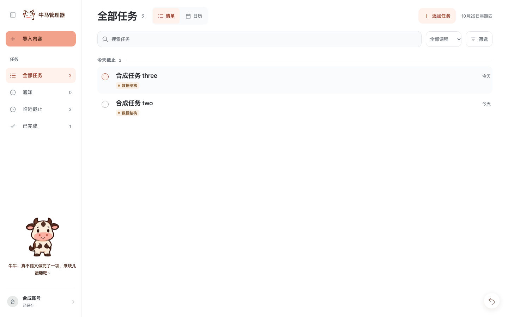
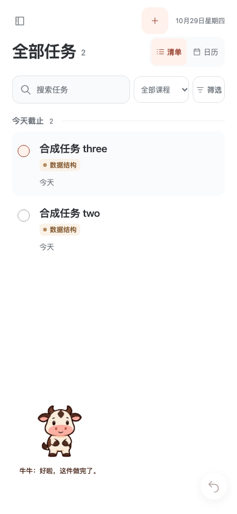

# 牛马伙伴

牛牛温和地肯定完成，马马像熟悉的朋友轻松提醒；两者不责备、不比较，也不推测任务难度、用户心情或“超额”。沿用奶油白牛、焦糖棕马、深棕轮廓及圆润蹄形。

## 角色与位置

使用账号全部已保存任务：有任何逾期留小马，没有逾期留小牛；完成反馈不轮换角色。通知、回收站、取消任务与未确认候选不计入。今日到达有效具体截止时刻即可逾期，仅有日期的任务等到次日；最近的明确截止时刻自动安排更新，搜索和课程筛选不影响伙伴判断。

默认左下角，话语位于角色脚下，撤回是独立的右下角44px小圆按钮。纯白背景，桌面、手机和窄屏均保留固定角色及字幕空间；动作不改变停靠位置。初次读取直接采用正确角色，不播放接班剧情。

## 完整接班剧情

| 变化 | 动作 |
| --- | --- |
| 小牛→小马 | 同一清单从右加速飞来，约225ms到头顶；起包、捂头退场；小牛尚在退出时小马已经入场，接着弯腰捡起清单、举起走回站定。 |
| 小马→小牛 | 牛从固定洞口冒头晃勾牌；马注意到后用铅笔逐步画勾、收好清单并向左走出；牛完整爬出，双足走回站姿。 |

两段约5.2秒、默认无声，所有剧情保留。角色与洞口分别定位，画面不随另一角色出现重新居中；晃牌、落笔之间没有额外长停。普通更新不截断已开始的影片，只保留最新角色目标，演完再决定是否反向接班。

## 随机完成动作

手动完成且保存成功后，当前角色从自己的动作池随机选择；同一角色避免连续重复，2秒内连做多项合并数量和话语。

| 角色 | 动作 |
| --- | --- |
| 牛牛 | 约3秒摆胯、交替踏步、甩手及小跳落地；或拿蛋糕、点奶油、舔蹄、举起仰头吃完、拍拍肚子。 |
| 马马 | 戴眼镜仔细端详清单、点头，用铅笔逐步画勾，再收笔摘镜；或持清单做简短认可动作。 |

蛋糕期间使用“真不错又做完了一项，来块儿蛋糕吧~”，结束后恢复最新完成话语。每个完整动作均从统一站姿出发，结束回同一站姿；表演期间新完成只保留一个最新意图，不从动作中途切换。通知阅读、重开、后台同步与保存失败不庆祝；没有剩余任务时普通话语改说收工。

## 循环待机与唤醒

90秒没有点击、输入、按键、滚动或完成操作后进入待机；普通鼠标经过不唤醒，也不自动跟随视线。

- 牛牛拉来枕头躺下睡觉，呼吸与Zzz循环；醒来后起身、伸懒腰，把枕头藏到背后收好。
- 马马拉来放着咖啡杯的桌子，循环写清单、喝咖啡、放回杯子；离开时拿回清单并把桌子、杯子和笔一起收走。

点击正在待机的伙伴只唤醒，不追加一个动作；完成任务时先等当前循环到安全末帧，播放完整唤醒或收桌，再接完成动作。内部循环首尾闭合；进入、退出和完整动作之间均通过统一站姿衔接。有逾期变化时，顺序为退出待机、接班剧情、最新完成回应。任务保存不等待动画。详情内完成且在反馈有效期内关闭详情时，才播放尚未开始的最新一次完成动作；过期反馈不补播。

## 操作、计时与异常

悬停约350ms只显示话语，点击主动回应或唤醒，拖动后靠边；方向键移动，Home复位，Escape收起话语。角色和字幕保留固定高度，动作期间省略号默认隐藏，键盘聚焦或打开菜单后仍可操作。

完成话语和最近一次撤回通常保留约7秒；悬停、聚焦、完整剧情、前景动作及唤醒时暂停收起计时，普通待机循环不长期暂停撤回。撤回入口独立于伙伴；关闭伙伴仍能撤回，账号切换清除旧账号的反馈。

页面隐藏、弹窗覆盖、账号重置、关闭伙伴、关闭动画、系统减少动态或拖动会取消表演并落回正确静态角色；后台不播放待机循环。解除减少动态不会打断已经开始的新动作。素材加载失败时仍保留可用角色、话语和撤回。

## 素材与实现

`src/assets/companions/pet-v5/` 保存随机动作、待机与接班图集，每张4×4格、2048×1536，单格512×384，保留透明通道；舞蹈32帧、蛋糕48帧、牛休息32帧、马检查32帧、马伏案48帧，接班各48帧。`companion-motion.js` 管理动作、循环、随机池和可取消时序，`companion-story.js` 管理接班节奏；`pet-v3/` 提供常驻与异常备用素材。

## 界面示例

界面截图使用真实前端与隔离合成API；待机截图使用同一伙伴组件的隔离验收页，均不含真实账号资料。

设计参考：[OpenAI Pets](https://learn.chatgpt.com/docs/pets) 的分状态动画、拖动与减少动态；任务判断、牛马剧情和角色话语为本产品设计。
